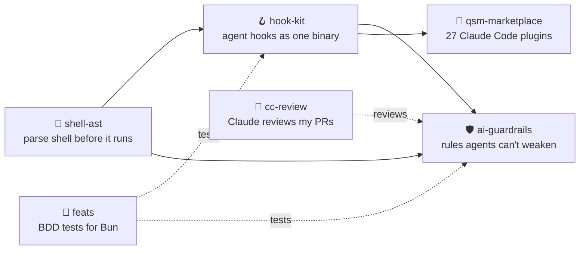

# Hey, I'm Jakub 👋

---

## 🧭 How I build

| | |
| --- | --- |
| ✂️ **The best code is the code not written.** | Every file, flag and test has to say what is missing without it. |
| 📏 **Measure, don't claim.** | Every number in my READMEs comes with the command that produced it. |
| 💥 **Fail loud.** | One path, no silent fallback. A dead program tells no lies. |
| 🎯 **Intent first.** | I write down what the work is for before I write the work. |
| 🔁 **Prove it on the real path.** | An end-to-end run beats a test that restates the code. |
| 🛡️ **Agents need rules they cannot remove.** | Guardrails live outside the agent: in hooks, commits and CI. |

## 🛠️ What I build

A small stack for letting a coding agent check its own work. Each layer is its own repo and its own npm package.

<table>
<tr>
<td width="50%" valign="top">

### 🧰 [qsm-marketplace](https://github.com/Questi0nM4rk/qsm-marketplace)
My daily Claude Code setup as a marketplace of 27 small plugins: skills, agents, hooks and CLI tools that help an agent see, verify and evaluate its own work.

 

</td>
<td width="50%" valign="top">

### 🤖 [cc-review](https://github.com/Questi0nM4rk/cc-review)
A pull request reviewer that runs Claude Code in GitHub Actions and posts inline comments as its own GitHub App.

 

</td>
</tr>
<tr>
<td width="50%" valign="top">

### 🛡️ [ai-guardrails](https://github.com/Questi0nM4rk/ai-guardrails)
Hooks, a commit gate and a CI check that flag when a coding agent weakens a project's own lint and hook rules.

 

</td>
<td width="50%" valign="top">

### 🪝 [hook-kit](https://github.com/Questi0nM4rk/hook-kit)
Builds coding-agent hooks into one compiled binary that decides through stdout, stderr and the exit code.

 

</td>
</tr>
<tr>
<td width="50%" valign="top">

### 🌳 [shell-ast](https://github.com/Questi0nM4rk/shell-ast)
A typed AST for bash, POSIX sh and mksh, so a tool can read a command before it runs.

 

</td>
<td width="50%" valign="top">

### 🥒 [feats](https://github.com/Questi0nM4rk/feats)
A BDD runner that turns Gherkin feature files into typed `bun:test` suites.

 

</td>
</tr>
<tr>
<td width="50%" valign="top">

### 🧠 [tagen](https://github.com/Questi0nM4rk/tagen)
Resolves a query against a catalog of skill cards and returns the matching set as a manifest.

</td>
<td width="50%" valign="top">

### 🗂️ [vori](https://github.com/Questi0nM4rk/vori)
Queries Obsidian-style markdown vaults from the terminal: tags, wikilinks, full text.

</td>
</tr>
</table>

> 🧪 **Experiment:** [codebase-mcp](https://github.com/Questi0nM4rk/codebase-mcp) was my first try at code retrieval for agents. It taught me where over-engineering starts, and its README says so.

## 🎴 Away from the terminal

- 🃏 I do cardistry and card tricks.
- 🌀 I obsess over a random new thing for a month, then forget what I did a week later.
- 🔧 I like owning my tools, so I build them. Even my desktop is my own: [qsm-desktop](https://github.com/Questi0nM4rk/qsm-desktop) is a Quickshell shell for Hyprland, built on the [qsm-shell](https://github.com/Questi0nM4rk/qsm-shell) component library and previewed in [qsm-workbench](https://github.com/Questi0nM4rk/qsm-workbench).
- ⌨️ I type on a split Dactyl I built myself, running ZMK on nice!nano v2 boards: [zmk-config-lozor](https://github.com/Questi0nM4rk/zmk-config-lozor).

 
