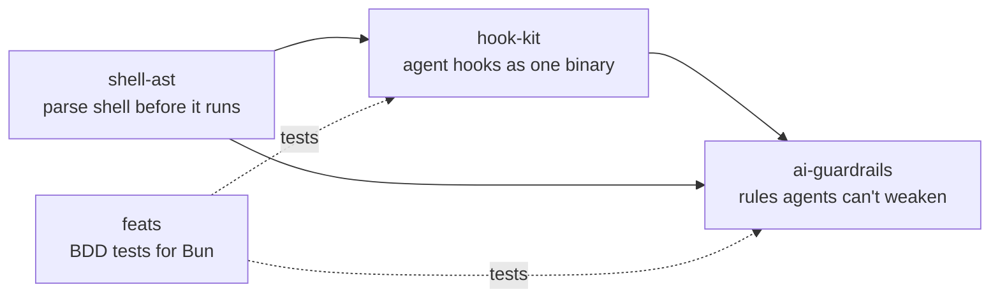

# Jakub Lozynskyj

**Backend engineer (.NET) by day. In my own time I build the tooling that lets a coding agent check its own work.**

TypeScript · Bun · shell · C#

## How I build

- **The best code is the code not written.** Every file, flag and test has to say what is missing without it.
- **Measure, don't claim.** Every number in my READMEs comes with the command that produced it.
- **Fail loud.** One path, no silent fallback. A dead program tells no lies.
- **Intent first.** I write down what the work is for before I write the work.
- **Prove it on the real path.** An end-to-end run beats a test that restates the code.
- **An agent needs rules it cannot remove.** Guardrails sit outside the agent, in hooks, commits and CI.

## What I build

| Repo | What it does |
| --- | --- |
| [ai-guardrails](https://github.com/Questi0nM4rk/ai-guardrails) | Hooks, a commit gate and a CI check that flag when a coding agent weakens a project's own lint and hook rules. |
| [hook-kit](https://github.com/Questi0nM4rk/hook-kit) | Builds coding-agent hooks into one compiled binary that decides through stdout, stderr and the exit code. |
| [shell-ast](https://github.com/Questi0nM4rk/shell-ast) | A typed AST for bash, POSIX sh and mksh, so a tool can read a command before it runs. |
| [feats](https://github.com/Questi0nM4rk/feats) | A BDD runner that turns Gherkin feature files into typed `bun:test` suites. |
| [tagen](https://github.com/Questi0nM4rk/tagen) | Resolves a query against a catalog of skill cards and returns the matching set as a manifest. |
| [vori](https://github.com/Questi0nM4rk/vori) | Queries Obsidian-style markdown vaults from the terminal: tags, wikilinks, full text. |

**Experiments:** [codebase-mcp](https://github.com/Questi0nM4rk/codebase-mcp) was my first try at code retrieval for agents. It taught me where over-engineering starts, and its README says so.
